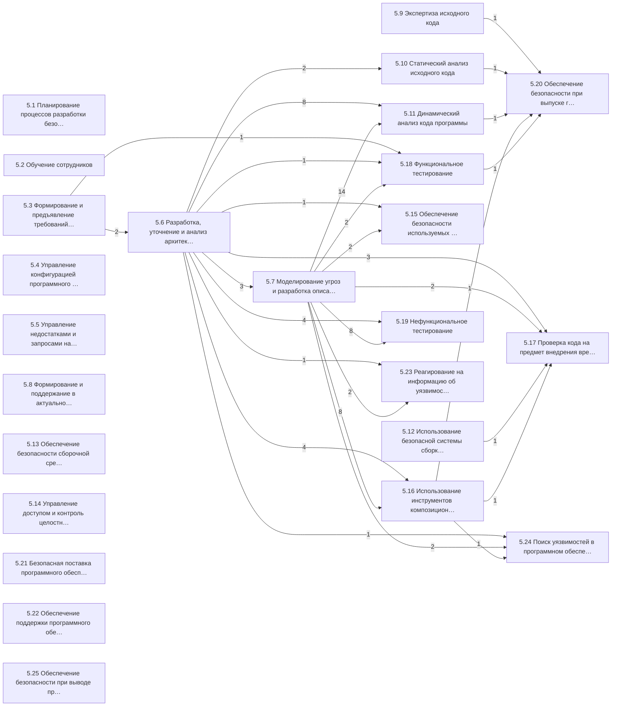

# rbpo-evidence

ГОСТ Р 56939-2024 «Защита информации. Разработка безопасного программного обеспечения. Общие
требования» в машиночитаемом виде: 25 процессов, 118 требований и 98 артефактов, ссылки между
ними и проверка полноты свидетельств проекта. Сопоставление с NIST SSDF 1.1 и со свидетельствами
стенда [`scii-gate`](https://github.com/alexqzm/scii-gate).

> **Это не официальное издание стандарта и не его текст.** Из стандарта взяты номера пунктов,
> наименования процессов, уровни обязательности требований и ссылки между пунктами. Формулировки
> требований и артефактов — краткие пересказы автора модели. Официальный текст стандарта
> распространяет Росстандарт ([rst.gov.ru](https://www.rst.gov.ru)). Проверка полноты свидетельств
> — не оценка соответствия: её методику стандарт относит к отдельному национальному стандарту
> (п. 4.4).

## Зачем

В ГОСТ Р 56939-2024 каждый процесс описан целями, требованиями и артефактами, которые подтверждают
выполнение требований. Многие требования прямо называют «артефакты, учитываемые при выполнении
требования», в том числе артефакты других процессов. Значит, стандарт уже задаёт граф
доказательств: что на что опирается и чего не хватает, если артефакта нет.

Репозиторий превращает этот граф в данные:

- **модель** стандарта — процессы, требования с уровнем обязательности, артефакты и все ссылки
  «учитываемые при выполнении»;
- **проверка полноты свидетельств** — по манифесту проекта, где у каждого артефакта три состояния:
  подтверждает, опровергает, не предъявлен;
- **граф процессов** — кто чьи артефакты учитывает;
- **сопоставления** с NIST SSDF 1.1 и со свидетельствами стенда scii-gate.

## Модель в цифрах

| | |
|---|---|
| Процессы | 25 (5.1–5.25) и справочное приложение А, которое при аудите не оценивается |
| Требования | 118: обязательных 110, рекомендуемых 2 (5.8.2.4, 5.9.2.3), по усмотрению 6 (5.15.2.1–5.15.2.4, 5.24.2.3–5.24.2.4); «если применимо» — 5.13.2.6 |
| Артефакты | 98: обязательных 89, необязательных 9 («может/могут содержать») |
| Ссылки «учитываемые при выполнении» | 192, из них между процессами 79 (28 связей процессов) |

## Что показывает граф

- **Опорные артефакты — угрозы и архитектура.** 68 из 79 межпроцессных ссылок ведут к артефактам
  двух процессов: 5.7 «Моделирование угроз и разработка описания поверхности атаки» (40) и 5.6
  «Разработка, уточнение и анализ архитектуры» (28). Модель угроз (5.7.3.1) и описание поверхности
  атаки (5.7.3.3) учитывают по 18 требований других процессов.
- **Больше всего опираются на чужие артефакты** 5.11 динамический анализ (22 ссылки), 5.16
  композиционный анализ и 5.19 нефункциональное тестирование (по 12).
- **Сборка и целостность кода не связаны с выпуском.** Решение при выпуске (5.20.2.2) учитывает
  экспертизу кода, статический и динамический анализ, композиционный анализ и функциональное
  тестирование, но не артефакты сборочной среды (5.13) и не контроль целостности кода (5.14). У
  этих двух процессов, как и у восьми других, межпроцессных ссылок нет вовсе.

Ребро A → B означает, что требования процесса B учитывают артефакты процесса A; число на ребре —
количество таких ссылок.



## Состав

| Каталог | Что внутри |
|---|---|
| [`model/`](model) | модель стандарта `gost-r-56939-2024.yaml` |
| [`crosswalk/`](crosswalk) | сопоставления: NIST SSDF 1.1, свидетельства стенда scii-gate |
| [`schema/`](schema) | JSON Schema модели, манифеста и сопоставлений |
| [`rbpo_evidence/`](rbpo_evidence) | загрузка и проверка модели, проверка полноты, граф, сопоставления, CLI |
| [`examples/`](examples) | манифест и отчёт для стенда scii-gate (сценарий B1) |
| [`tools/`](tools) | получение манифеста из результатов scii-gate |
| [`docs/model.md`](docs/model.md) | как построена модель и что в ней интерпретация |

## Быстрый старт

```sh
pip install -e .
rbpo-evidence stats                                   # сводка по модели
rbpo-evidence validate                                # целостность модели и сопоставлений
rbpo-evidence check examples/scii-gate-B1/manifest.yaml
rbpo-evidence graph --mermaid --manifest examples/scii-gate-B1/manifest.yaml
rbpo-evidence crosswalk crosswalk/nist-ssdf-1.1.yaml
```

Без установки — `python3 -m rbpo_evidence …` из корня репозитория. Зависимость одна — PyYAML.

Манифест проекта (схема — [`schema/manifest.schema.json`](schema/manifest.schema.json)):

```yaml
schema: rbpo-evidence/manifest/v1
project: "Мой проект 2.3"
scope:
  exclude:                      # п. 4.14–4.15: состав процессов определяет заказчик или НД
    - {process: "5.25", reason: "вывод из эксплуатации вне договора"}
artifacts:
  "5.10.3.4": {state: P, ref: "reports/sast-2.3.sarif", sha256: "…"}
  "5.16.3.2": {state: P, ref: "sbom/cyclonedx.json"}
  "5.17.3.5": {state: F, note: "антивирусная проверка нашла угрозу в стороннем компоненте"}
```

Артефакт, которого нет в манифесте, считается непредъявленным.

## Правила проверки

У артефакта три состояния, как в методе SCII: **P** — предъявлен и подтверждает выполнение,
**F** — предъявлен и опровергает, **N** — не предъявлен. Статус процесса:

| Статус | Когда |
|---|---|
| опровергнуто | есть артефакт в состоянии F (аналог вето) |
| не хватает свидетельств | не предъявлен хотя бы один обязательный артефакт |
| подтверждено | все обязательные артефакты подтверждены, опровержений нет |
| по усмотрению, не предъявлено | процесс применяется по усмотрению (5.15), свидетельств нет |
| вне области | процесс исключён в манифесте с обоснованием |

Итог: опровергнуто, если опровергнут хотя бы один процесс; иначе не хватает свидетельств, если их
не хватает хотя бы у одного; иначе полнота подтверждена. Код возврата `check`: 0, 10 и 30
соответственно, 2 — ошибка входных данных. Отчёт отдельно перечисляет межпроцессные последствия:
требования, которые учитывают неподтверждённый артефакт другого процесса.

## Пример: стенд scii-gate

[`examples/scii-gate-B1`](examples/scii-gate-B1) — манифест, полученный из результатов стенда
scii-gate (сценарий B1, эталонная цепочка поставщика ArduPilot Copter-4.5.7) через сопоставление
[`crosswalk/scii-gate.yaml`](crosswalk/scii-gate.yaml), и отчёт проверки.

Технические свидетельства цепочки подтверждают 11 артефактов из 98 в 8 процессах: контроль
изменений (5.4.3.3), отчёт статического анализа (5.10.3.4), сведения о сборочной среде (5.12.3.2),
сведения о её безопасности, журналы аудита сборки, хранение результатов и повторяемость сборки
(5.13.3.2, 5.13.3.4–5.13.3.6), контроль целостности кода (5.14.3.3), перечень зависимостей
(5.16.3.2), отчёт о функциональном тестировании (5.18.3.2), проверку целостности пакета
(5.20.3.4). Результаты экспертизы кода (5.9.3.2) в B1 не предъявлены: свидетельство рецензирования
изменений (s12) в этом сценарии не предъявлено.
Ни один процесс при этом не подтверждён целиком: регламенты, планы и описания — артефакты
организационные, свидетельства цепочки их не заменяют. Три свидетельства устройства (защита от
отката, привязка к плате, аппаратная аттестация) прямого артефакта в стандарте не имеют.

## Сопоставления

- **NIST SP 800-218 (SSDF) 1.1** — соответствие есть у 24 процессов из 25. У 5.25 «Вывод из
  эксплуатации» соответствия в SSDF нет. В ГОСТ нет прямого соответствия практикам PW.9
  (безопасные настройки по умолчанию) и RV.3 (анализ первопричин уязвимостей). Версия 1.2 на
  момент составления — проект.
- **Стенд scii-gate** — 14 типов свидетельств из 17 указывают на 12 артефактов ГОСТ.

Сопоставления — интерпретация автора модели на уровне «связано», а не эквивалентность.

## Ограничения

- Формулировки (`label`) — пересказы; при работе с требованием сверяйтесь с официальным текстом.
- Артефакт, названный в стандарте без оговорок «может/могут», считается обязательным — это
  правило модели, см. [`docs/model.md`](docs/model.md).
- Ссылка «учитываемые при выполнении» связывает требование с артефактами, на которые оно
  опирается; какой артефакт подтверждает само требование, стандарт указывает не везде, и модель
  этого не достраивает.
- Цели процессов (подпункты x.1) в версию 0.1 не включены.

## Планы

- Сопоставления с методикой ФСТЭК России от 12.04.2026, IEC 62443-4-1, SLSA, ГОСТ Р 71207-2024
  (к 5.10), ГОСТ Р 58412 (угрозы, к 5.7), ГОСТ Р 58143-2018 (к 5.19).
- Количественная оценка по графу процессов методом SCII (через scii-gate).
- Цели процессов и привязка требований к подтверждающим их артефактам.

## Связанные репозитории

- [`scii-gate`](https://github.com/alexqzm/scii-gate) — гейт допуска обновлений ПО КФС по графу
  доказательств (метод SCII) и стенд ArduPilot, DOI
  [10.5281/zenodo.23833592](https://doi.org/10.5281/zenodo.23833592).
- [`scii-verify`](https://github.com/alexqzm/scii-verify) — проверка квитанции допуска SCII на
  устройстве.

## Лицензии

Код — Apache-2.0 ([`LICENSE`](LICENSE)). Данные — модель, сопоставления и примеры (`model/`,
`crosswalk/`, `examples/`) — CC BY 4.0 ([`LICENSE-DATA`](LICENSE-DATA)).

## Как сослаться

Метаданные — в [`CITATION.cff`](CITATION.cff); DOI появится после первого выпуска через Zenodo.

---

### Summary (EN)

A machine-readable model of the Russian national standard GOST R 56939-2024 (secure software
development): 25 processes, 118 requirements with obligation levels, 98 artifacts, and all 192
"artifacts considered when fulfilling the requirement" references, 79 of them across processes —
the standard's own evidence graph. The package checks a project's evidence manifest
(present-confirming / present-refuting / absent, as in the SCII method), exports the process
graph, and maps the standard to NIST SSDF 1.1 and to the evidence types of the scii-gate testbed.
The model does not reproduce the standard's text: only clause numbers, process titles, obligation
levels and cross-references are taken from it; labels are the author's paraphrases. Evidence
completeness is not a conformity assessment. Code: Apache-2.0; data: CC BY 4.0.
